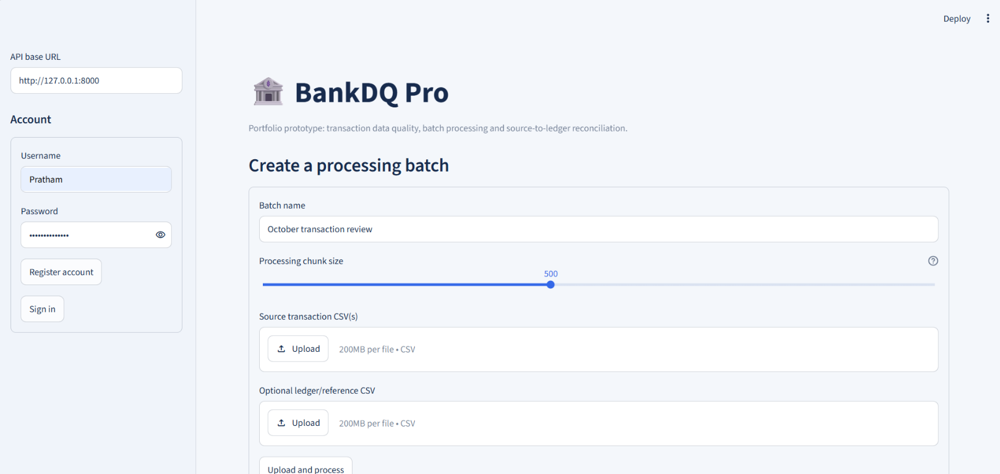
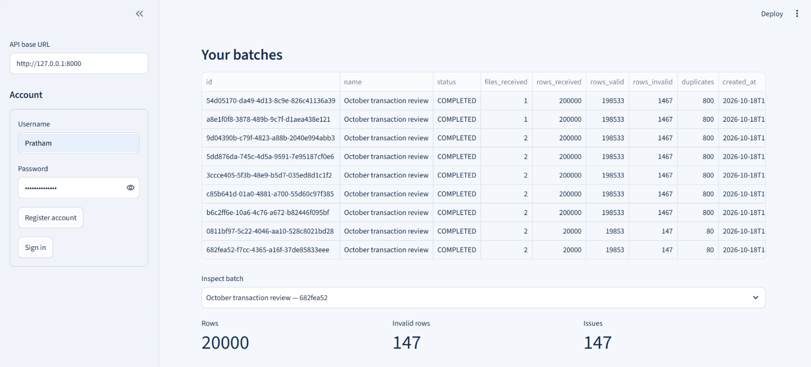
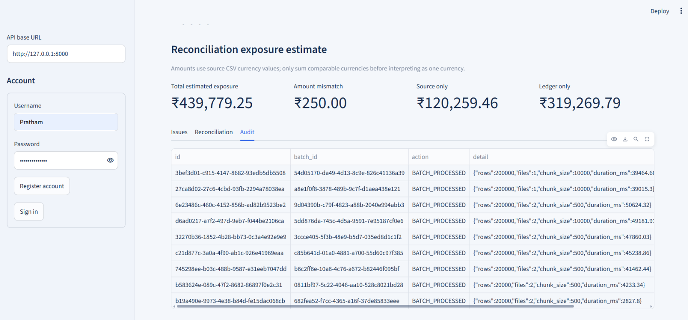

# BankDQ Pro — Banking Data Quality, Batch Processing & Reconciliation

**Portfolio prototype, not production banking/compliance software.** Use synthetic data only.

## Why this project is relevant to financial services

BankDQ Pro demonstrates a common operational control problem: ingesting transaction extracts from multiple systems, finding data-quality defects, reconciling source records against a ledger, and retaining an audit trail of processing actions. It does not claim regulatory certification or production readiness.

## Features

- **Custom multi-file batch upload:** up to 20 source CSV files plus one optional reference/ledger CSV per batch.
- **Configurable chunk size:** choose 50–10,000 rows per processing chunk; records are flushed to the database per chunk.
- **Reference-based reconciliation:** matched, source-only, ledger-only, duplicate-reference, amount/account/date/currency mismatch statuses.
- **Data quality checks:** missing transaction ID, malformed amount/date, repeated transaction ID, and possible duplicate business key (`account_id + transaction_date + amount + currency`).
- **Authentication and tenant isolation:** account registration, PBKDF2 password hashing, signed bearer tokens, owner-scoped batch/issue/reconciliation/audit queries.
- **Financial-exposure prioritization:** quantifies amount-mismatch deltas and source-only/ledger-only amounts so reviewers can prioritize reconciliation breaks. Mixed currencies must not be summed as if they were one currency.
- **Operational visibility:** structured JSON logs, per-batch metrics, audit trail, paginated issue and reconciliation endpoints, CSV export.
- **Database migration scaffold:** Alembic configuration and initial schema revision.
- **Engineering workflow:** pytest tests, Ruff lint in GitHub Actions, Docker and Docker Compose for PostgreSQL.
- **Repeatable benchmark suite:** reports isolated CSV parse/duplicate-scan throughput, labeled quality/reconciliation metrics, and optional API timing to `benchmark/results.json` and `benchmark/results.csv`.

## CSV schema

Uploaded source and ledger files must be UTF-8 CSV files with a header row. Both
file types use the same schema. A CSV can contain one transaction per data row;
do not include JSON, Excel formatting, totals rows, or multiple header rows.

### Copy-ready CSV format

```csv
transaction_id,account_id,transaction_date,amount,currency,description
TX00000001,AC0000001,2026-01-15,1250.50,INR,UPI transfer
TX00000002,AC0000002,2026-01-16,89.99,USD,POS purchase
```

### Columns

| Column | Required | Expected format and rules |
| --- | --- | --- |
| `transaction_id` | Yes | Non-empty transaction/reference identifier. It should be unique within a source or ledger file. Duplicate IDs are reported as data-quality or reconciliation issues. |
| `amount` | Yes | Numeric monetary value, such as `1250.50` or `1,250.50`. Values are stored with two decimal places. Missing, non-numeric, or non-finite values such as `NaN` and `Infinity` are invalid. |
| `account_id` | Recommended | Account identifier used for reconciliation. If omitted or blank, the row receives a `MISSING_ACCOUNT_ID` issue and account-level reconciliation cannot be reliable. |
| `transaction_date` | Recommended | ISO date in `YYYY-MM-DD` format, such as `2026-01-15`. Invalid dates receive an `INVALID_DATE` issue. |
| `currency` | Recommended | Currency code such as `INR`, `USD`, `EUR`, or `GBP`. Values are normalized to uppercase. Use one consistent currency per comparison set; mixed currencies are not summed together. If omitted, the application defaults it to `INR`. |
| `description` | Optional | Free-text description. It is retained for display and is limited to 500 characters. It is not used as the primary reconciliation key. |

### File and header requirements

- File names must end in `.csv`.
- Files must be UTF-8 encoded; UTF-8 with a byte-order mark is also accepted.
- The first row must contain column names.
- Header capitalization and spaces are normalized. For example,
  `Transaction ID` is interpreted as `transaction_id`.
- At least `transaction_id` and `amount` must be present in the header.
- Blank values in required columns are invalid and are reported during
  processing.
- A batch can contain up to 20 source CSV files and one optional ledger CSV.
- Each uploaded file is limited to 25 MB.
- The dashboard supports a processing chunk size from 50 to 10,000 rows.
  Chunking affects database flushes, not CSV file-size limits or parallelism.

### Source and ledger usage

Upload source files as the transactions received from the source system.
Upload the optional ledger file as the reference set for reconciliation. The
application primarily matches records by `transaction_id`, then compares:

- Amount
- Account
- Transaction date
- Currency

Supported reconciliation statuses include `MATCHED`, `AMOUNT_MISMATCH`,
`ACCOUNT_MISMATCH`, `DATE_MISMATCH`, `CURRENCY_MISMATCH`, `SOURCE_ONLY`,
`LEDGER_ONLY`, and `DUPLICATE_REFERENCE`.

Rows with missing or invalid values are retained for issue reporting, but they
may not be eligible for a reliable match. Use the exact same column names and
format in source and ledger files where possible.

## Windows setup (Command Prompt)

```cmd
cd E:\Fintech Projects\bankdq_pro
python -m venv .venv
.venv\Scripts\activate.bat
python -m pip install -r requirements.txt
copy .env.example .env
python scripts\generate_synthetic_data.py --rows 1000 --out sample_data\generated
python -m uvicorn app.main:app --reload
```

Open `http://127.0.0.1:8000/docs`. Register via `/auth/register`, log in at `/auth/login`, then click **Authorize** and enter `Bearer <access_token>` (or use the Streamlit dashboard).

In a second terminal, from the same project directory:

```cmd
.venv\Scripts\activate.bat
python -m streamlit run dashboard\app.py
```

Dashboard URL: `http://localhost:8501`.

## Use the Streamlit dashboard

The following walkthrough uses the included dashboard and synthetic CSV data.

### 1. Configure the API and account

Start the API and dashboard using the commands above. In the dashboard sidebar, confirm the API base URL, enter a username and password, and register or sign in.



### 2. Create and process a batch

1. Enter a batch name.
2. Select a processing chunk size from 50 to 10,000 rows.
3. Upload one or more source transaction CSV files.
4. Optionally upload a ledger/reference CSV to enable reconciliation.
5. Select **Upload and process**.
6. Wait for the upload and server-side processing progress to complete.

The source CSV must include `transaction_id` and `amount`. Use synthetic data only.

### 3. Review batch history

After processing completes, the batch appears in **Your batches**. Select a batch to review its status, received rows, valid rows, invalid rows, and duplicate count.



### 4. Review quality, reconciliation, and audit results

Use the batch tabs to inspect:

- **Issues** — invalid amounts, missing fields, duplicate transaction IDs, and other data-quality findings.
- **Reconciliation** — matched records and source-only, ledger-only, duplicate-reference, and field-mismatch statuses. This tab is available when a ledger file was uploaded.
- **Audit** — processing events and batch metadata.

The reconciliation exposure metrics use the currency codes in the uploaded source data. Mixed currencies are shown separately rather than being treated as one currency.



## Use batch upload in Swagger

1. Register and login; copy `access_token` from `/auth/login`.
2. Click **Authorize** and paste `Bearer YOUR_TOKEN`.
3. Expand `POST /batches`.
4. Add one or more `files`, choose `name`, set `chunk_size` (50–10000), and optionally attach `ledger_file`.
5. Inspect `/batches/{batch_id}/issues`, `/reconciliation`, `/metrics`, and `/audit`.

## Migrations

For a fresh local database, the app creates tables for convenience. To use migrations deliberately:

```cmd
alembic upgrade head
```

For subsequent schema changes, create a migration with `alembic revision --autogenerate -m "describe change"` and review it before applying. In a production deployment, disable startup `create_all` and use migrations as a controlled deployment step.

## Benchmark

Run the isolated benchmark suite with the default 1,000, 10,000, 50,000, and
100,000-row deterministic datasets:

```cmd
python scripts\run_benchmark_suite.py --repeats 5 --seed 42 --include-api
```

The suite writes:

- `benchmark/results.json` — complete machine-readable results, environment,
  dataset sizes, seed, repeated-run medians, memory observations, and
  evaluation metrics.
- `benchmark/results.csv` — one row per dataset and isolated benchmark stage.

To run a smaller or faster local check:

```cmd
python scripts\run_benchmark_suite.py --sizes 1000 10000 --repeats 3 --include-api
```

The performance stages are deliberately separate:

- **CSV parsing** measures only CSV decoding and row construction.
- **Duplicate-ID scanning** measures only the in-memory transaction-ID scan.
- **API batch processing** (optional `--include-api`) measures an end-to-end
  request using a temporary SQLite database, including persistence and
  reconciliation. It must not be compared directly with microbenchmark
  throughput.

The evaluation stages use a separate, labeled fixture. Quality metrics match
issue code and CSV row number; duplicate groups count repeated rows after the
first. Reconciliation metrics compare expected status labels for matched,
amount, account, date, currency, missing-record, and duplicate-reference
scenarios. A matched-record percentage is reported as coverage, not accuracy.

All results are synthetic and local. Do not copy benchmark values from another
machine. Record the generated JSON with the command, hardware, Python version,
database configuration, and seed when reporting an Action-Work-Result metric.
The suite does not use production credentials or real banking data. Peak memory
uses Python `tracemalloc` and may not include native allocations.

## Tests and lint

```cmd
pytest -q
ruff check app tests scripts dashboard
```

## API endpoints

- `POST /auth/register`, `POST /auth/login`, `GET /auth/me`
- `POST /batches` — multiple source files, optional `ledger_file`, custom `chunk_size`
- `GET /batches`, `GET /batches/{id}`, `GET /batches/{id}/metrics`
- `GET /batches/{id}/issues?page=1&page_size=50`
- `GET /batches/{id}/reconciliation?page=1&page_size=50`
- `GET /batches/{id}/reconciliation.csv`
- `GET /audit?page=1&page_size=50`
- `GET /health`

## Important limitations and security notes

- Prototype only: not PCI DSS, SOC 1/2, RBI, or other regulatory-compliance certified.
- The included token implementation is intended for learning; use a vetted identity provider or reviewed JWT/OAuth library for a real deployment.
- Add rate limiting, HTTPS, secret management, retention controls, malware scanning, file streaming, and security review before any production use.
- Chunk size controls processing chunking, not parallelism. The CSV file is currently read into memory before row-level chunking; for very large files, switch to a streaming parser.
- Business-key duplicate detection is heuristic and may flag legitimate repeated transactions. It is a warning, not a definitive fraud finding.
- Reconciliation uses transaction ID as the primary reference and compares amount, account, date, and currency. It is not a complete double-entry ledger control.
- Synthetic records only; do not upload real banking/customer data.
